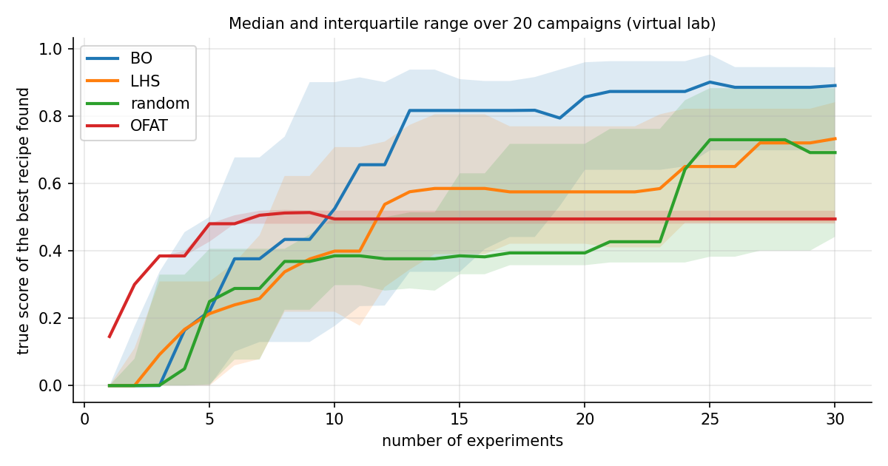

# Bayesian optimisation for nanoparticle synthesis — a tutorial for chemists

A short, readable introduction to **closed-loop optimisation of a nanoparticle synthesis**, written by a materials
chemist for chemists. Five notebooks follow one question from start to finish:

> *Which recipe gives 10 nm iron-oxide nanoparticles with a narrow size distribution,
> with as few syntheses as possible?*

Every step is written out explicitly, in plain scikit-learn and NumPy, so that each line can be checked by hand.



*Same budget of 30 experiments, 20 independent campaigns on the virtual lab (median and interquartile range).
The closed loop (BO) reaches a median true score of **0.89** (IQR 0.70–0.95), against 0.73 for a 30-point Latin
hypercube, 0.69 for random recipes and 0.50 for one-factor-at-a-time, which stops on a ridge because two
variables interact.*

---

## ⚠️ What the data are — and are not

The "experiments" run on a **virtual lab** (`src/nanobo/virtual_lab.py`): an **invented** response surface with
measurement noise. It mimics a few qualitative features of the thermal decomposition of iron oleate (size grows with
temperature, the best ligand ratio moves with temperature) so that the strategies can be compared on a problem with
realistic difficulties. **It is not fitted to real data and must not be used to draw chemical conclusions.**
Because the lab is virtual, the *true* score of every recipe is known, which is what makes an honest benchmark possible.

## The notebooks

| # | notebook | what you learn |
|---|---|---|
| 1 | [Design space and Latin hypercube](notebooks/01_design_space_and_latin_hypercube.ipynb) | why 6 well-spread recipes beat a 216-point grid or random picks for a first round |
| 2 | [From measurements to one score](notebooks/02_from_measurements_to_one_score.ipynb) | turning size + dispersion into one bounded number; why a score without a floor misleads the model |
| 3 | [The Gaussian process](notebooks/03_gaussian_process.ipynb) | prediction **and** uncertainty; reading length scales; why repeats are needed to see the noise; down-weighting a flagged experiment |
| 4 | [Expected improvement and batches](notebooks/04_expected_improvement_and_batches.ipynb) | exploit vs explore in one formula; choosing a *batch* of different recipes (kriging believer); not chasing a lucky measurement |
| 5 | [Closed loop and benchmark](notebooks/05_closed_loop_and_benchmark.ipynb) | the full loop, and a fair comparison with LHS, random and one-factor-at-a-time |

The notebooks are stored **with their outputs**, so they can be read directly on GitHub.

## Quick start

```bash
git clone https://github.com/<your-account>/nanoparticle-bo-tutorial.git
cd nanoparticle-bo-tutorial
python -m venv .venv && source .venv/bin/activate      # Windows: .venv\Scripts\activate
pip install -r requirements.txt
jupyter lab notebooks/
```

The notebooks import the local package from `src/`, so no installation is needed (`pip install -e .` also works).
Run the tests with `pytest`.

## The package in one screen

```python
import nanobo as nb

X = nb.latin_hypercube(6, seed=42)                    # round 0: 6 recipes (real units)
size, disp = nb.VirtualLab(seed=1).run(X)             # "synthesise and measure"
y = nb.desirability_score(size, disp)                 # one score per experiment, 0-1

U = nb.to_unit(X)                                     # all variables on a 0-1 scale
gp = nb.make_gp().fit(U, y)                           # Matérn (one length per variable) + noise
nb.describe(gp)                                       # length scales, learned noise

next_U = nb.kriging_believer(gp, U, y, n_batch=6)     # 6 different recipes chosen by EI
next_X = nb.from_unit(next_U)

campaign = nb.run_bo(n_init=6, batch=6, n_rounds=4)   # or the whole loop at once
```

| module | content |
|---|---|
| `space.py` | the three variables, their ranges, conversion to/from the unit cube |
| `design.py` | Latin hypercube, random design, slice check |
| `virtual_lab.py` | the invented response surface + noise (+ optional batch effect) |
| `scores.py` | penalty score and desirability score |
| `model.py` | Gaussian process (scikit-learn), learned hyperparameters in plain numbers |
| `acquisition.py` | expected improvement, incumbent choice, kriging-believer batches |
| `campaign.py` | full campaigns (BO, LHS, random, OFAT) and the benchmark metric |

## Limits and next steps

* 3 variables and one objective; real campaigns have more variables, constraints and several targets
  (→ Pareto fronts, e.g. qNEHVI in [BoTorch](https://botorch.org)).
* Noise is constant here; real noise can depend on the recipe and drift between batches
  (`VirtualLab(batch_sd=...)` is a starting point for exploring this).
* The batch is chosen greedily (kriging believer); joint batch selection (qEI / qNEI) is more rigorous.
* scikit-learn was chosen for transparency; BoTorch is the natural next step for larger problems.

## Author

**Sakina Meftah** — materials chemist (synthesis of magnetic iron-oxide nanocrystals, SAXS, magnetism).
ORCID [0009-0007-9598-7109](https://orcid.org/0009-0007-9598-7109)

Related publications:

* S. Meftah et al., "Striking effect of the iron stearate purity on the shape and size of maghemite nanoparticles",
  *Colloids Surf. A* **680**, 132689 (2024).
* S. Meftah et al., "Synthesis and magnetic properties of spherical maghemite nanoparticles with tunable size and
  surface chemistry", *Langmuir* **40**, 22673–22683 (2024).
* S. Meftah et al., "In situ synthesis of iron oxide–polyisobutylene multifunctional nanocomposites: size control,
  magnetic and mechanical properties enhancement", *ACS Appl. Polym. Mater.* **7**, 5150–5160 (2025).

If you use this material, please cite it (see `CITATION.cff`).

## License

MIT — see [LICENSE](LICENSE).
